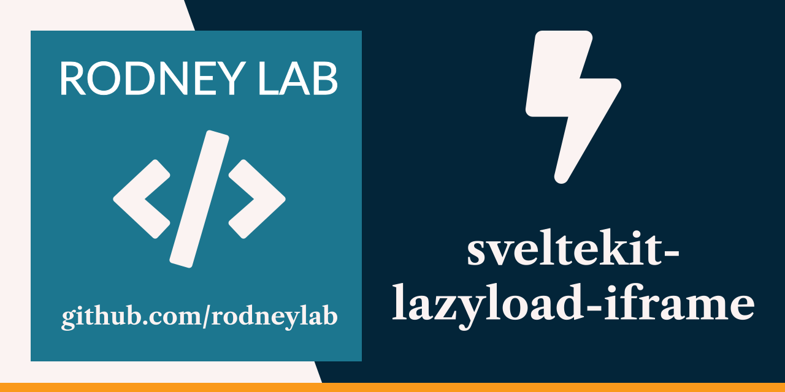

  

<h1 align="center">
  SvelteKit Lazy Load iframe
</h1>

# sveltekit-lazyload-iframe

## 🌏  Open in the Cloud 

Click any of the buttons below to start a new development environment to demo or contribute to the codebase without having to install anything on your machine:

SvelteKit demo code for responsive lazy loading iframes. See the video in the post at <a aria-label="Read Rodney Lab blog post on implementing lazy loading iframes in Svelte Kit" href="https://rodneylab.com/lazy-loading-iframes-sveltekit/">rodneylab.com/lazy-loading-iframes-sveltekit/ to see why lazy loading is important</a> and how it can improve Core Web Vitals metrics used by Google for ranking search results.

Please drop questions into a comment at the bottom of that video post pages.

Feel free to jump into the [Rodney Lab matrix chat room](https://matrix.to/#/%23rodney:matrix.org).
